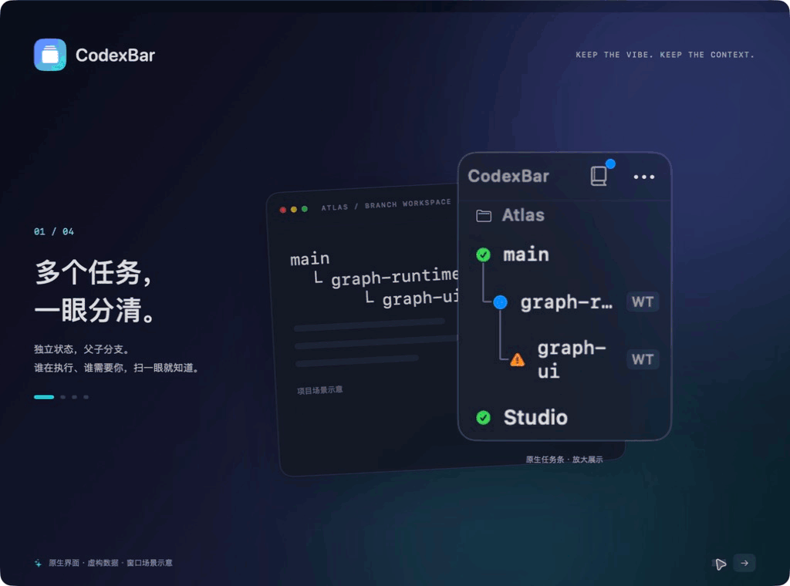
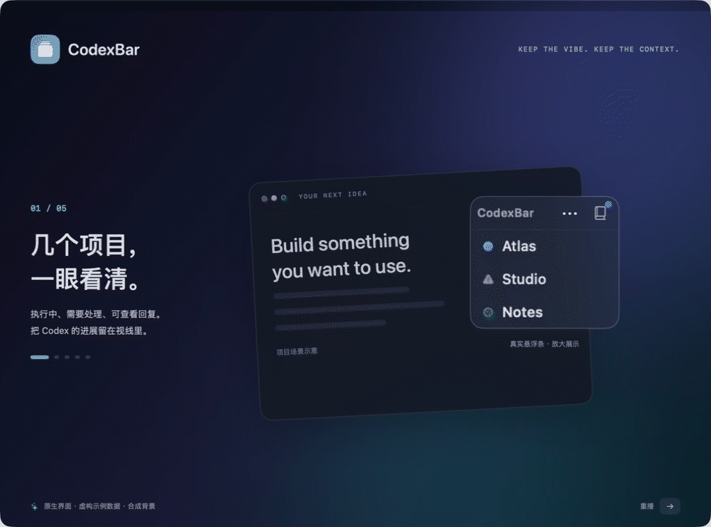

<div align="center">

<h1>CodexBar</h1>

### 少切窗口，多看进展。

为 **VS Code Codex** 打造的 macOS 原生悬浮条。<br>
看多项目进展，悬停读回复，点击回到工作区；也能独立阅读 **Obsidian 知识库**。

[](https://github.com/zmylol/CodexBar/actions/workflows/ci.yml) [](#快速开始) [](Package.swift) [](LICENSE) [](PRIVACY.md)

[快速开始](#快速开始) · [功能演示](#看看它怎么工作) · [工作区与分支](#工作区与分支并行开发也能分清) · [知识库](#知识库今天收了什么一眼读明白) · [使用指南](docs/USER_GUIDE.md)

</div>

## 看看它怎么工作

<p align="center"></p>

<sub>18 秒原生界面操作剪辑，使用虚构任务与对话；项目窗口切换为场景示意。<a href="docs/images/task-demo-poster.png">静态预览</a> · <a href="scripts/marketing-demo/README.md">演示制作说明</a></sub>

| 你想做什么 | CodexBar 可以帮你 |
| :--- | :--- |
| **掌握多个项目的进展** | 汇总执行中、需要处理、可查看状态；已打开但没有任务的工作区仍保留入口 |
| **直接读回复和工具输出** | 悬停打开会话预览，阅读 Markdown、代码块，展开命令结果、翻阅历史和选择文字 |
| **回到对应项目** | 点击项目名或“切到项目”切换窗口；需要专注时，从项目菜单选择最小化其他 VS Code 窗口 |
| **管理并行开发目录** | 按仓库组织 Git worktree，创建子 worktree、切换本地分支，保留目录创建层级 |
| **调整桌面上的占用** | 拖动或停靠四角，自定义悬浮条宽高，选择紧凑、固定高度滚动或自动展开；设置自动保存 |
| **补读知识库文章** | 按库查看今天、昨天、近七天的文章与摘要，记住已查看状态，点击打开原文 |

“可查看”表示当前一轮已停止，结果是否符合预期仍需你验收。会话预览中的部分运行中输出可能稍后同步。

## 快速开始

当前通过源码构建安装，需要 **macOS 13+、Swift 6.0+ 和 Xcode Command Line Tools**。

```sh
git clone https://github.com/zmylol/CodexBar.git
cd CodexBar
scripts/install-app
open "$HOME/Applications/CodexBar.app"
```

安装后，按你需要的功能完成连接：

### 连接 VS Code 任务

需要官方 **VS Code Stable** 和支持 Hooks 的 **OpenAI Codex IDE 扩展**。

1. 打开 CodexBar 菜单 → **连接与设置 → 安装或更新任务连接…**，也可在源码目录运行 `scripts/install-hooks`。
2. 重新加载 VS Code，在 **Codex Settings → Hooks** 中检查、审核并信任配置。安装器会备份配置并保留第三方 Hooks。
3. 在 **系统设置 → 隐私与安全性 → 辅助功能** 中允许 CodexBar，用于同步和切换项目窗口。
4. 在 VS Code 中打开项目并发起 Codex 任务，回到悬浮条查看进展。同一窗口新建会话并开始任务后，会自动跟随。

[完整安装步骤](docs/USER_GUIDE.md#开始使用) · [连接状态与排查](docs/USER_GUIDE.md#连接状态与排查) · [Hooks 兼容性](docs/HOOK_COMPATIBILITY.md)

### 连接 Obsidian 知识库

点击顶部 **书本** 入口，自动识别或手动选择包含 `.obsidian` 的知识库总目录，一级文件夹会作为分类显示。文章需要有效的 `type: article` 和 `collected` 信息；无需连接 VS Code 或安装 Hooks。

[知识库配置攻略](docs/KNOWLEDGE_SETUP.md) 提供目录结构、可复制的文章示例和每日收录任务提示词。

> **更新已有安装：** 先退出 CodexBar，在源码目录执行 `git pull --ff-only` 后重新运行 `scripts/install-app`。源码构建使用 ad-hoc 签名，更新后可能需要重新授予辅助功能权限；如需更新 Hooks，重新运行任务连接安装器，再在 Codex 中审核并加载。正式分发要求见[发布指南](docs/RELEASING.md)。

## 工作区与分支：并行开发也能分清

从菜单打开 **工作目录与分支…**，添加 Git 项目，就能查看各工作目录的当前分支、切换本地分支，或从所选目录创建新分支和子 worktree。

```text
example-project · main
└─ worktree-runtime · graph-runtime
   └─ worktree-ui · graph-ui
```

- **目录关系会保留。** 创建层级保存到本机，支持多层嵌套和重启恢复。切换分支只更新名称，节点仍留在原处；导入的既有 worktree 若没有创建记录，会显示“创建来源未知”。
- **分支跟随当前目录。** 在树中选中目录即可查看它的分支；获得辅助功能权限后，也会跟随前台可明确识别的 VS Code 单目录工作区。
- **悬浮条对应已打开的窗口。** 同仓库的目录分组显示，保留 `主目录` / `WT` 标记。本地多项目工作区合并为一条入口，支持已保存的 `.code-workspace` 和未命名工作区。

新 worktree 从来源目录的**当前提交**创建，不复制未提交修改。Git 操作失败会显示原因，不会强制覆盖文件。[工作区操作与识别规则 →](docs/USER_GUIDE.md#日常操作)

## 知识库：今天收了什么，一眼读明白

独立于任务列表使用。自动化或其他工具把文章写入本地 Markdown 后，CodexBar 监听文件变化，按北京时间的 `collected` 日期整理阅读清单。

<p align="center"></p>

<sub>20 秒原生界面操作剪辑，文章与到达事件均为虚构样例。<a href="docs/images/demo-poster.png">静态预览</a> · <a href="scripts/marketing-demo/README.md">演示制作说明</a></sub>

- **按库阅读，随时补读。** 切换今天、昨天或近七天，查看标题和摘要；点击带有效原文链接的文章，用默认浏览器继续阅读。
- **记住看过的文章。** 点击知识库清除当前范围内的未查看数字，文章列表保留；近七天的已查看记录在重启后恢复。新文章再次提醒，旧文修改或补写摘要不会重复提醒。
- **只读你选择的目录。** 在“管理目录”中取消勾选，或右键“排除此目录”，即可停止读取并隐藏分类；重新勾选可恢复，原文件保留。

摘要取自文章已有的摘要首段，没有摘要时只显示标题。CodexBar 不生成或核验摘要，也不改写笔记。[文章格式与提醒规则 →](docs/USER_GUIDE.md#自动化分批收录文章到达就显示)

## 按你的屏幕调整

从右上角菜单打开 **界面大小…**，调节悬浮条宽高，选择紧凑、自定义高度滚动或自动展开。设置即时生效并在重启后保留，尺寸受屏幕可见范围限制，也可一键恢复默认。[尺寸与显示模式 →](docs/USER_GUIDE.md#让进展留在视线里)

SwiftUI + AppKit 原生界面，支持浅色与深色外观，无第三方 Swift Package 依赖。

## 支持范围与隐私

| 环境或场景 | 当前支持 |
| :--- | :--- |
| macOS + 官方 VS Code Stable + Codex IDE 扩展 | 本地任务状态、会话预览与项目窗口切换 |
| 本地多项目工作区 / Git worktree | 工作区归并、独立目录入口、分支切换与 worktree 创建 |
| Obsidian 知识库 | 独立阅读本地文章，可搭配 Codex 桌面端、CLI 或其他工具写入的 Markdown |
| Codex 桌面端 / Codex CLI 的任务和会话 | 暂未接入 |
| Cursor / Windsurf / VS Code Insiders | 暂不支持 |
| Windows / Linux / 远程任务 | 暂不支持 |

窗口切换需要唯一匹配工作区；同名、重复窗口等存在歧义时不会切换。“暂无任务”只表示没有可显示的任务，不代表扩展已经连接。会话预览依赖扩展的内部本地接口，兼容性会随版本变化。[完整支持范围 →](docs/USER_GUIDE.md#支持范围)

**内容在本机处理。** 无需 CodexBar 账号，无遥测或主动上传内容的网络客户端。会话预览与知识库正文在内存中处理，任务元数据、工作目录创建关系和偏好保存在本机；官方 Codex 组件与服务遵循其自身数据规则。点击文章会交由浏览器访问原文网站。[隐私说明 →](PRIVACY.md)

## 开发与文档

| 命令 | 用途 |
| :--- | :--- |
| `scripts/test` | 完整测试入口：核心、应用模型、Hooks、模拟端到端、构建与隔离安装等检查 |
| `scripts/build-app` | 构建本机架构的 `dist/CodexBar.app` |
| `scripts/install-app` | 构建并安装到 `~/Applications/CodexBar.app` |

核心测试使用 `codexbar-tests` 可执行目标，请以 `scripts/test` 为准。界面与性能检查见[开发指南](docs/USER_GUIDE.md#开发与贡献)。

[使用指南](docs/USER_GUIDE.md) · [知识库配置](docs/KNOWLEDGE_SETUP.md) · [贡献指南](CONTRIBUTING.md) · [架构说明](docs/ARCHITECTURE.md) · [发布流程](docs/RELEASING.md) · [安全问题](SECURITY.md)

---

<div align="center">

如果 CodexBar 帮你少切了几次窗口，欢迎 **Star**，或带着使用体验一起改进。

[报告问题 / 提出建议](https://github.com/zmylol/CodexBar/issues) · [参与贡献](CONTRIBUTING.md)

<sub><a href="LICENSE">MIT License</a> · 独立社区项目，与 OpenAI 或 Microsoft 没有隶属或背书关系。相关商标归各自权利人所有。</sub>

</div>
